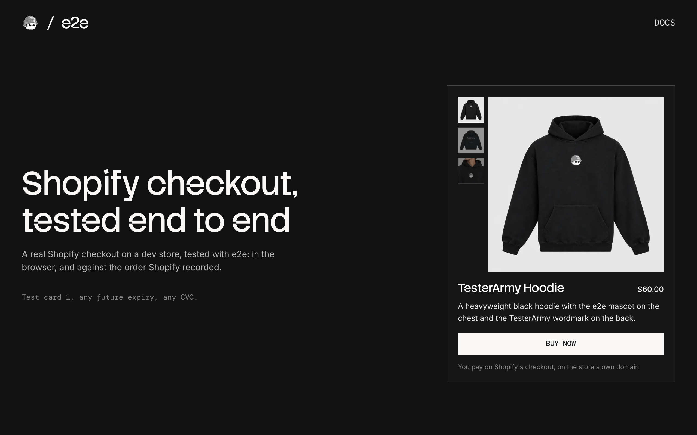

# e2e-shopify

A Next.js storefront that sells one product through Shopify's checkout on a free dev store, used as an example of end-to-end testing a checkout you don't own with [e2e](https://www.npmjs.com/package/e2e).



## How it works

The shopper pays on Shopify's own checkout, the one every Shopify store uses:

- **Home** (`app/page.tsx`) shows the store's newest product for sale, read through the Storefront API.
- **`POST /checkout`** (`app/checkout/route.ts`) creates a cart with it and redirects to Shopify's checkout.
- **Shopify's checkout** ends on Shopify's thank-you page. Nothing sends the shopper back, so the tests confirm each order through the Admin API.

There is no database: Shopify holds the product, the cart, and the order.

### Test cards

| Card number | Result          |
| ----------- | --------------- |
| `1`         | Paid            |
| `2`         | Declined        |
| `3`         | Gateway failure |

Use any future expiry date, any security code, and any name. Shopify shows the same error for `2` and `3`.

## Getting started

Connect a Shopify store first (below, about 15 minutes), then:

```bash
npm install
cp .env.example .env.local   # then fill it in
npm run dev
```

Open [http://localhost:3000](http://localhost:3000). The card shows your product, and Buy now opens Shopify's checkout. If the card says **Connect your dev store**, a variable is missing; **Nothing for sale** means no active product is in the Headless channel.

## Connect your Shopify store

Everything here is free. The steps end with the values for `.env.local`.

### 1. Create a dev store

1. Sign in to the [Shopify Dev Dashboard](https://dev.shopify.com/dashboard/). The store and the app in step 5 must be in the same organization.
2. Create the store with Shopify's CLI, which can set the country (the tests' buyer has a US address):

   ```bash
   npx @shopify/cli@latest store create dev --country US
   ```

   It asks for a name, which becomes `<name>.myshopify.com`, a plan, and whether to add demo data. Any answers work.

3. The Test payment gateway is on already: **Settings → Payments** shows it as **Active**.

→ `SHOPIFY_STORE_DOMAIN`, such as `e2e-shopify.myshopify.com`.

### 2. Add a product

The app sells the newest product that's for sale. In the admin, go to **Products → Add product**:

- **Price:** over $5.00, for the discount test.
- **Media:** any photos, each with alt text. The starred one comes first.
- **Inventory:** turn the toggle off, so the tests never run out of stock.
- **Status:** **Active**.

### 3. Get a Storefront API token

A dev store's password locks its Online Store channel, so the Storefront API needs a token from the free Headless channel:

1. Install [Headless](https://apps.shopify.com/headless) on your store.
2. Go to **Sales channels → Headless** and add a storefront.
3. In **Storefront API tokens**, copy the **Public access token**. It's public by design.
4. Add your product to the channel: **Products**, select it, **⋯ → Include in sales channels → Headless**.

→ `SHOPIFY_STOREFRONT_TOKEN`.

### 4. Copy the store password

Dev stores are always password protected, and the password page stands in front of checkout too. It's under **Online Store → Preferences**.

→ `SHOPIFY_STORE_PASSWORD`, in single quotes if it contains `#` or `$`.

### 5. Create an app for the Admin API

Only the tests use it, to check and delete orders.

1. In the [Dev Dashboard](https://dev.shopify.com/dashboard/), go to **Apps → Create app → Start from Dev Dashboard**.
2. On **Versions**, set the **App URL** to `https://shopify.dev/apps/default-app-home` with **Embed app in Shopify admin** off, and the **Scopes** to `read_orders,write_orders,read_discounts,write_discounts`. Then **Release**.
3. **Install app** on your store.
4. Under **Distribution**, choose **Custom distribution** with your store's domain, or the app can't read orders. Skip the install link it shows.
5. On **Settings**, copy the **Client ID** and **Client secret**.

→ `SHOPIFY_CLIENT_ID` and `SHOPIFY_CLIENT_SECRET`.

### 6. Add an AI Gateway key

The tests' agent calls its model through the Vercel AI Gateway: create a key in the Vercel dashboard under **AI Gateway → API Keys**, or link a Vercel project, which gives the Gateway an OIDC token instead.

→ `AI_GATEWAY_API_KEY`.

## End-to-end tests

`tests/store.setup.e2e.ts` clicks Buy now, lands on the dev store's password page, and has the agent type the password as a `secrets` handle: the model only sees `<secret:store-password>`. It saves the session, so every checkout test starts past the password.

`tests/checkout.e2e.ts` pays with cards `1`, `2`, and `3`, and with a discount code. Our page uses exact locators and Shopify's checkout uses `agent.act` and `agent.assert`, except the card fields: they're iframes from another site, which the agent can't see, so the test fills them with `browser.frameLocator`. Then each test asks the Admin API what Shopify recorded:

- **Paid:** a test order, paid, for the product and price on our card.
- **Declined or failed:** no order.
- **Discount:** the test creates a fresh code through the Admin API first, and the order lists it with $5.00 off.

Until every variable is set, the checkout tests are skipped with the names of the missing ones, and only the home test runs. Orders and codes are deleted afterwards, even after a failure, and the tests refuse a store that isn't a development store. Tests on Shopify's page retry twice. A run takes about 2.5 minutes and $0.02 of model calls.

With the dev server running:

```bash
npm run test:e2e
```

To test a different URL, set `APP_URL`. Configuration lives in `e2e.config.ts`.

## Scripts

| Command            | Description          |
| ------------------ | -------------------- |
| `npm run dev`      | Start the dev server |
| `npm run build`    | Build for production |
| `npm run lint`     | Run ESLint           |
| `npm run format`   | Format with Prettier |
| `npm run test:e2e` | Run the e2e tests    |
